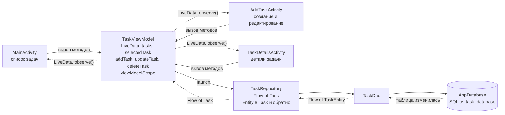
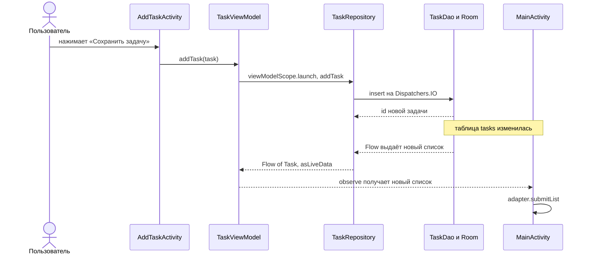

# Этап 4. Архитектура MVVM

## 1. Схема слоёв и потока данных

Сплошные стрелки — команды (вниз), пунктирные — данные (вверх). Цепочка: **UI (Activity) → ViewModel → Repository → Room (DAO, база)**.

## 2. Что происходит при добавлении задачи

Главный экран не перезапрашивает данные сам: новый список приходит по подписке, поэтому `onResume()` с ручной загрузкой больше не нужен.

## 3. Слои и пакеты

| Слой | Пакет | Классы | Ответственность |
|---|---|---|---|
| UI (View) | `ui` | `MainActivity`, `AddTaskActivity`, `TaskDetailsActivity`, `TaskAdapter` | Только отображение и обработка нажатий. Нет обращений к `TaskDao`/`AppDatabase` |
| ViewModel | `viewmodel` | `TaskViewModel` | Состояние экрана (LiveData), методы `addTask()`, `updateTask()`, `deleteTask()`, корутины в `viewModelScope` |
| Repository | `data` | `TaskRepository`, `TaskMapper.kt` | Единственная точка доступа к данным, преобразование `TaskEntity` ↔ `Task`, выбор потока записи |
| Room | `data` | `TaskEntity`, `TaskDao`, `AppDatabase` | Хранение данных в SQLite |
| Модель | `model` | `Task` | Объект задачи, с которым работают ViewModel и экраны |

## 4. Ответы на вопросы этапа

**Зачем нужен Repository, если ViewModel может обращаться к DAO напрямую?**
- ViewModel не должна зависеть от способа хранения: она работает с обычными объектами `Task` и ничего не знает о Room, Entity и SQL. Если источник данных изменится (появится сеть или кэш), правки останутся внутри Repository.
- Вся работа с базой собрана в одном месте: преобразование Entity ↔ Task, переключение на `Dispatchers.IO`, защита записи от отмены, логирование. Иначе этот код пришлось бы дублировать в каждой ViewModel.
- Так проще расширять приложение: на этапе 7 при сохранении задачи Repository сможет заодно планировать напоминание, не меняя экраны.
- ViewModel с таким слоем проще тестировать: Repository можно заменить на «заглушку».

**Почему данные не пропадают при повороте экрана?**
При повороте система пересоздаёт Activity, но `ViewModel` остаётся в памяти (она хранится в `ViewModelStore`, который переживает смену конфигурации). Новая Activity получает тот же объект через `by viewModels()` и сразу получает последнее значение LiveData. Запрос к базе повторно не выполняется: подписка на `Flow` (`asLiveData()`) остаётся активной ещё 5 секунд после отключения подписчика, а пересоздание экрана занимает доли секунды.

**Как проверить поворот экрана?**
1. Открыть приложение с несколькими задачами, в Logcat поставить фильтр `tag:TaskRepository` — виден один `READ`.
2. Повернуть эмулятор (кнопка Rotate). Список остался на месте, а новая строка `READ` в Logcat не появилась: данные взяты из ViewModel, а не из базы.

**Что делают `observe()` и `viewModelScope`?**
`observe(this) { ... }` подписывает экран на LiveData: код в скобках вызывается каждый раз при изменении данных, но только пока экран активен. Подписка снимается сама при уничтожении Activity, поэтому утечек нет. `viewModelScope` — область корутин, привязанная к ViewModel: корутины в ней отменяются автоматически, когда ViewModel уничтожается.

**Почему запись в Repository выполняется в `NonCancellable`?**
После сохранения экран сразу закрывается (`finish()`), а вместе с ним уничтожается ViewModel и отменяется её `viewModelScope`. Без `NonCancellable` корутина записи могла бы быть отменена раньше, чем запись в базу завершится.

**Почему `ListAdapter` и `DiffUtil`?**
`submitList(newList)` сравнивает старый и новый списки (`DiffUtil`) и обновляет только изменившиеся карточки. Вручную вызывать `notifyDataSetChanged()` не нужно.

## 5. Проверка критериев этапа

| Критерий | Как выполнен / как проверить |
|---|---|
| Activity не обращаются к `TaskDao`/`AppDatabase` | В пакете `ui` таких обращений нет. Проверка: `grep -rn "TaskDao\|AppDatabase" app/src/main/java/ru/university/taskcalendar/ui` — результат пустой |
| Список обновляется без ручного вызова | Добавить, изменить и удалить задачу: список на главном экране обновляется сам (подписка `observe` в `MainActivity`) |
| Данные не пропадают при повороте | См. проверку выше |
