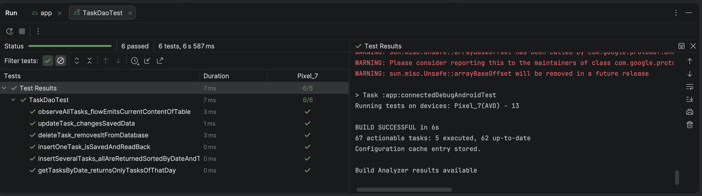
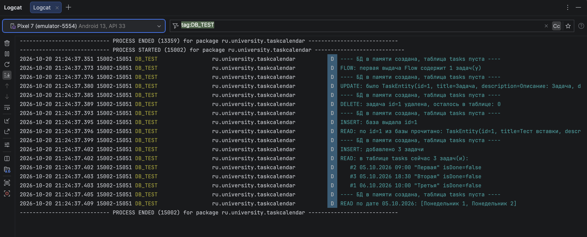

# Отчёт по этапу 3. Локальное хранилище: Room

## 1. Что реализовано

| Элемент | Класс / файл | Назначение |
|---|---|---|
| `@Entity` | `data/TaskEntity.kt` | Описывает таблицу `tasks`. `@PrimaryKey(autoGenerate = true)` — id выдаёт сама база |
| `@Dao` | `data/TaskDao.kt` | `insert`, `update`, `delete`, `getAllTasks`, `getTasksByDate`, `getTaskById` и наблюдаемые запросы на `Flow` (добавлены на этапе 4) |
| `RoomDatabase` | `data/AppDatabase.kt` | Единая база `task_database`, один экземпляр на приложение (синглтон с двойной проверкой внутри `synchronized`) |

Столбцы таблицы `tasks`: `id` (INTEGER, первичный ключ), `title`, `description`, `date`, `time` (TEXT), `isDone` (INTEGER 0/1).

Запись идёт через экран добавления (`AddTaskActivity`), чтение — на главном экране (`MainActivity`) и экране деталей.

## 2. Явный тест вставки

Файл: `app/src/androidTest/java/ru/university/taskcalendar/data/TaskDaoTest.kt`.
Тест выполняется на эмуляторе над базой в памяти (данные приложения не затрагиваются) и проверяет:

| Тест | Что проверяет |
|---|---|
| `insertOneTask_isSavedAndReadBack` | Вставка одной задачи: база выдала id > 0, задача читается обратно с теми же полями |
| `insertSeveralTasks_allAreReturnedSortedByDateAndTime` | Вставка трёх задач, чтение всех, сортировка по дате и времени |
| `getTasksByDate_returnsOnlyTasksOfThatDay` | Запрос задач за конкретную дату |
| `updateTask_changesSavedData` | Обновление |
| `deleteTask_removesItFromDatabase` | Удаление |
| `observeAllTasks_flowEmitsCurrentContentOfTable` | Чтение через `Flow` |

Каждый шаг пишется в Logcat с тегом `DB_TEST`.

## 3. Доказательство, что данные сохраняются и читаются

**а) Тест пройден (окно Run в Android Studio):**

**б) Logcat теста, фильтр `tag:DB_TEST` (строки `INSERT` и `READ`):**

**в) Logcat самого приложения, фильтр `tag:TaskRepository`:** после добавления задачи через экран «Добавление задачи» видна строка `INSERT`, а после возврата на главный экран — строка `READ` с этой же задачей.

Дополнительно: *View → Tool Windows → App Inspection → Database Inspector* показывает таблицу `tasks` с живыми данными. Скриншоты самого приложения лежат в [Screenshots.md](../Screenshots.md).

## 4. Ответы на вопросы этапа

**Что произойдёт с данными при закрытии и повторном открытии приложения?**
Они сохранятся. Room хранит данные в файле SQLite `task_database` во внутреннем хранилище приложения (`/data/data/ru.university.taskcalendar/databases/`). Этот файл лежит на диске, а не в памяти процесса, поэтому закрытие приложения его не затрагивает. Данные исчезнут только при удалении приложения или очистке его данных в настройках Android.

**Как обеспечена асинхронность?**
Все методы DAO, меняющие или читающие данные разово, объявлены как `suspend`: Room выполняет их не в главном потоке. Запросы на `Flow` Room тоже выполняет в фоновом потоке. Вызываются они из корутин (`viewModelScope.launch`, запись дополнительно на `Dispatchers.IO`). Обычный (не `suspend`) метод DAO, вызванный из главного потока, привёл бы к исключению: так Room защищает интерфейс от «зависаний».

**Чем `@Query("SELECT * FROM tasks")` лучше «сырого» SQL?**
В чистом SQLite нужно вручную вызывать `rawQuery`, перебирать `Cursor`, доставать значения по именам столбцов и собирать из них объекты. Ошибка в имени столбца обнаружится только во время работы приложения. Room проверяет SQL-запрос при компиляции, сам генерирует код преобразования строк в `TaskEntity`, возвращает типизированный результат (`List<TaskEntity>`) и поддерживает `suspend` и `Flow`.